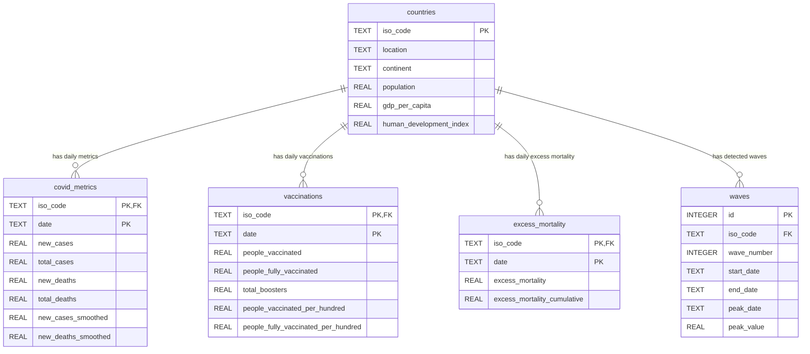

# ER diagram v1

SQLite schema used by `data/covid.db`. A country (`countries.iso_code`) owns zero or
more daily metric rows, vaccination rows, excess-mortality rows and detected-wave rows.

## Keys and indexes

| Table | Primary key | Foreign key |
|---|---|---|
| `countries` | `iso_code` | — |
| `covid_metrics` | `(iso_code, date)` | `iso_code` → `countries.iso_code` |
| `vaccinations` | `(iso_code, date)` | `iso_code` → `countries.iso_code` |
| `excess_mortality` | `(iso_code, date)` | `iso_code` → `countries.iso_code` |
| `waves` | `id` (autoincrement) | `iso_code` → `countries.iso_code` |

Additional non-unique indexes exist on `date` and `(iso_code, date)` for the time-series
tables, and on `waves.iso_code`. The `waves` table is created by `sql/schema.sql` and is
populated later by the wave-detection step.
