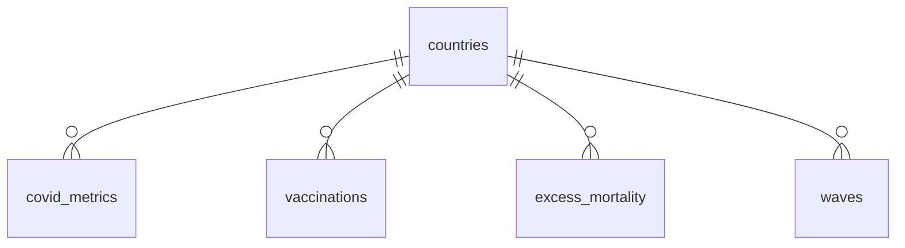

# SQL notes

Документ описывает SQLite-схему `data/covid.db`, запросы из `sql/queries.sql` и
обязательные SQL-конструкции, которые они демонстрируют. Схема создаётся
`sql/schema.sql`, база заполняется `scripts/build_sqlite.py`, запросы запускаются
`scripts/run_sql.py` (результаты сохраняются в `outputs/sql/query_NN.csv`).
`scripts/smoke_test.py` проверяет артефакты, таблицы и все запросы end-to-end.

## 1. ER-модель

Нормализованная схема «звезда» вокруг таблицы стран. Одна страна владеет нулём или
более строк ежедневных метрик, вакцинаций, избыточной смертности и обнаруженных волн.



| Таблица | Назначение | Первичный ключ | Внешний ключ |
|---|---|---|---|
| `countries` | справочник стран/территорий | `iso_code` | — |
| `covid_metrics` | ежедневные случаи, смерти, сглаженные значения | `(iso_code, date)` | `iso_code` → `countries.iso_code` |
| `vaccinations` | ежедневные показатели вакцинации и бустеры | `(iso_code, date)` | `iso_code` → `countries.iso_code` |
| `excess_mortality` | избыточная смертность | `(iso_code, date)` | `iso_code` → `countries.iso_code` |
| `waves` | найденные волны (заполняется анализом временных рядов) | `id` (autoincrement) | `iso_code` → `countries.iso_code` |

Индексы: `covid_metrics(date)`, `covid_metrics(iso_code, date)`,
`vaccinations(date)`, `vaccinations(iso_code, date)`,
`excess_mortality(iso_code, date)`, `waves(iso_code)`.

`date` хранится как `TEXT` в формате `YYYY-MM-DD`, поэтому SQL-функции
`substr(date, 1, 7)` (месяц) и `strftime('%Y', date)` (год) работают без приведения
типов. Таблица `waves` заполняется из `outputs/waves.csv`, если файл уже создан
скриптом `scripts/run_analysis.py`; если файла нет, таблица остаётся пустой, а
smoke-тест выдаёт WARN, а не FAIL. Поэтому в быстром старте сначала запускается
анализ, затем сборка SQLite.

## 2. Запросы

Все девять запросов используют реальные таблицы БД и загружают результат в Pandas
через `pd.read_sql_query`. Параметризованный запрос №9 при запуске скрипта получает
значения по умолчанию `year=2021`, `region=None`, `category=None`.

| № | Название | Обязательные конструкции | Что показывает |
|---:|---|---|---|
| 1 | Latest country snapshot | `JOIN`, скалярный подзапрос, `ORDER BY` | последняя дата с метриками и места стран по `total_cases` |
| 2 | Monthly global totals | `GROUP BY`, `HAVING`, `JOIN` | помесячные суммы случаев/смертей по странам с континентом |
| 3 | Countries above average vaccination | CTE, подзапрос, `JOIN` | страны с вакцинацией выше среднего на последнюю дату |
| 4 | Peak month by country | CTE, коррелированный подзапрос | месяц пика случаев для каждой страны |
| 5 | Vaccination rank by date | оконная функция `RANK() OVER (PARTITION BY ... ORDER BY ...)` | рейтинг стран по полной вакцинации на каждую дату |
| 6 | 7-day rolling average in SQL | оконная функция `AVG() OVER (... ROWS BETWEEN 6 PRECEDING AND CURRENT ROW)` | скользящее среднее новых случаев для United States |
| 7 | Vaccination and mortality by continent | CTE, `LEFT JOIN`, агрегация `AVG`/`SUM` | средняя вакцинация и суммарные смерти по континентам |
| 8 | Top three peaks per country | CTE, оконная функция `ROW_NUMBER() OVER (PARTITION BY ... ORDER BY ...)` | до трёх пиков `new_cases_smoothed` на страну |
| 9 | Dashboard filter query | `JOIN`, `LEFT JOIN`, `strftime`, именованные параметры | выборка для фильтров дашборда по году/региону/категории вакцинации |

### Покрытие обязательных конструкций

- `JOIN`: запросы 1, 2, 3, 4, 5, 6, 7, 8, 9.
- `GROUP BY` / `HAVING`: запрос 2 (а также агрегатный `GROUP BY` в 3, 4, 7, 8).
- Подзапрос / CTE: запросы 1, 3, 4, 7, 8.
- Оконные функции: запросы 5, 6, 8.
- Параметризованный запрос: запрос 9 (`:year`, `:region`, `:category`).

## 3. Категории вакцинации (запрос 9)

Категория определяется по `people_vaccinated_per_hundred` на ту же дату:

| Категория | Условие |
|---|---|
| `High` | `>= 70` |
| `Medium` | `>= 40 AND < 70` |
| `Low` | `>= 0 AND < 40` |
| `None` | `NULL` или `0` |

## 4. Хранение и замеры

- `data/processed/covid_merged.parquet` — объединённый очищенный датасет.
- `data/covid.db` — SQLite с нормализованными таблицами.
- `outputs/sql/query_NN.csv` — результаты запросов.
- `outputs/benchmark_data.json` — сравнение CSV и Parquet на одном наборе данных
  (`scripts/benchmark_storage.py`): время чтения, пиковая память `tracemalloc`,
  размеры файлов и ускорение. Оба замера выполняются на полностью материализованном
  DataFrame: PyArrow хранит данные в нативных буферах, которые `tracemalloc` не
  учитывает, поэтому после `read_parquet` данные копируются в pandas/numpy.

## 5. Запуск

```bash
.venv/bin/python scripts/build_merged_dataset.py
.venv/bin/python scripts/build_sqlite.py
.venv/bin/python scripts/run_sql.py
.venv/bin/python scripts/benchmark_storage.py
.venv/bin/python scripts/smoke_test.py
```
